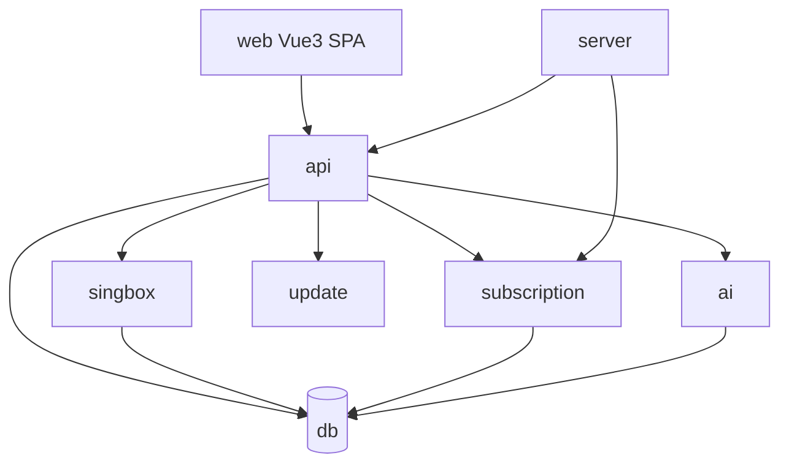

# 代码地图

> 仓库尚未建业务代码，以下均为**规划**目录；落码后由做改动的会话按「收尾」更新。

## 树

```text
proxy-ui/
├── main.go               # 入口：装配 db/各业务模块并启动面板服务（规划）
├── embed.go              # //go:embed web/dist（规划）
├── internal/
│   ├── server/           # Gin 路由装配、会话鉴权中间件、SPA 静态资源（规划）
│   ├── api/              # REST handlers：入站/出站/规则/设置/AI（规划）
│   ├── db/               # SQLite（glebarez+GORM）连接、模型、迁移（规划）
│   ├── singbox/          # sing-box 配置生成、内核子进程启停、状态采集（规划）
│   ├── subscription/     # 订阅导出：singbox/clash(mihomo) 格式、二维码、策略组与 anti-AD 规则（规划）
│   ├── update/           # 面板自更新 + sing-box 内核下载更新（规划）
│   └── ai/               # AI 供应商配置、对话代理、面板接口工具桥（规划）
└── web/                  # Vue3 SPA（独立 npm 包，bun + Vite）
    ├── src/
    │   ├── api/          # 后端接口封装（规划）
    │   ├── stores/       # Pinia（规划）
    │   ├── views/        # 页面：仪表盘/入站/出站/订阅/规则/设置/AI 助手（规划）
    │   ├── components/   # 通用组件（规划）
    │   └── router/       # 路由（规划）
    └── package.json      # 规划
```

## 模块

| 模块 | 路径 | 职责 | 主要入口 |
| --- | --- | --- | --- |
| server | `internal/server/` | 路由装配、会话、静态资源 | 装配函数（规划） |
| api | `internal/api/` | REST handlers，按资源分文件 | 规划 |
| db | `internal/db/` | SQLite 连接、模型、自动迁移 | 规划 |
| singbox | `internal/singbox/` | sing-box 配置生成与子进程生命周期 | 规划 |
| subscription | `internal/subscription/` | 多格式订阅导出、二维码、规则集 | 规划 |
| update | `internal/update/` | 面板与内核在线更新 | 规划 |
| ai | `internal/ai/` | AI 对话代理与工具桥 | 规划 |
| web | `web/` | Vue3 SPA 前端包 | `src/main.ts`（规划） |

## 依赖



## 关键路径

- **启动**：`main.go` → db 初始化/迁移 → server 装配路由与嵌入资源 → 拉起 sing-box 子进程
- **订阅拉取**：客户端 GET 订阅链接（匿名 token）→ server 分流 → subscription 按 UA/参数渲染 sing-box / clash(mihomo) 配置返回
- **在线更新**：面板点击 → update 从 GitHub Releases 下载 → 替换二进制/内核 → 重启生效
- **AI 工具调用**：前端 `@veltra/ai` 对话 → ai 模块代理供应商 API → function calling 回落到 api/业务模块执行 → 结果回流对话
