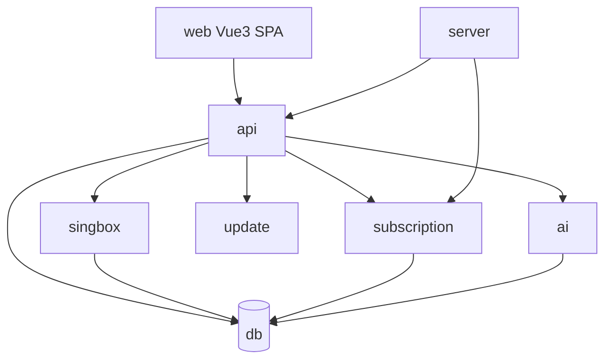

# 代码地图

> `main.go`/`embed.go`/`internal/server`/`internal/api`/`internal/db`/`web`/`scripts/` 已落码；`singbox`/`subscription`/`update`/`ai` 包仍为**规划**，落码后由做改动的会话按「收尾」更新。

## 树

```text
proxy-ui/
├── main.go               # 入口：解析启动参数（addr/data/db）、初始化数据库并启动 HTTP 服务
├── embed.go              # //go:embed all:web/dist 嵌入前端构建产物
├── internal/
│   ├── server/           # Gin 路由装配、会话中间件与统一守卫、SPA 静态资源回退
│   ├── api/              # REST handlers，按资源分文件；已落：首次设置/登录/登出/me/改密
│   ├── db/               # SQLite（glebarez+GORM）连接、全量模型、启动自动迁移
│   ├── singbox/          # sing-box 配置生成、内核子进程启停、状态采集（规划）
│   ├── subscription/     # 订阅导出：singbox/clash(mihomo) 格式、二维码、策略组与 anti-AD 规则（规划）
│   ├── update/           # 面板自更新 + sing-box 内核下载更新（规划）
│   └── ai/               # AI 供应商配置、对话代理、面板接口工具桥（规划）
├── scripts/
│   └── build.sh          # 一键构建：前端（web 包存在时）+ linux/amd64、darwin/arm64 交叉编译（禁 CGO）
└── web/                  # Vue3 SPA（独立 npm 包，bun + Vite）
    ├── dist/             # 前端构建产物（bun run build 生成），go:embed 嵌入；.gitkeep 占位保底
    ├── src/
    │   ├── api/          # 请求封装（envelope 解包、401 跳登录、错误提示）与鉴权接口
    │   ├── stores/       # Pinia：auth 鉴权状态（初始化/会话/登录/登出/改密）
    │   ├── views/        # 页面：向导/登录/仪表盘/入站/出站/规则/订阅/AI 助手/设置
    │   ├── components/   # 通用组件：AppLayout 侧边导航布局
    │   └── router/       # 路由与守卫（未登录重定向、已初始化后向导不可达）
    └── package.json      # bun + Vite + TS + Vue3 + @veltra/desktop + Pinia + Vue Router
```

## 模块

| 模块 | 路径 | 职责 | 主要入口 |
| --- | --- | --- | --- |
| server | `internal/server/` | 路由装配、会话守卫、SPA 静态资源 | `New(Options)` |
| api | `internal/api/` | REST handlers，按资源分文件；已落鉴权与首次设置 | `New(db, sessions)` |
| db | `internal/db/` | SQLite 连接、全量模型、自动迁移 | `Open(path)` |
| singbox | `internal/singbox/` | sing-box 配置生成与子进程生命周期 | 规划 |
| subscription | `internal/subscription/` | 多格式订阅导出、二维码、规则集 | 规划 |
| update | `internal/update/` | 面板与内核在线更新 | 规划 |
| ai | `internal/ai/` | AI 对话代理与工具桥 | 规划 |
| web | `web/` | Vue3 SPA：底座、布局导航、登录/向导、设置骨架；业务页面待后续阶段填充 | `src/main.ts` |

## 依赖

已落码部分：`web` → `api`（REST，开发模式经 Vite 代理）、`server` → `api` → `db`；其余边为规划（singbox/subscription/update/ai 落码后生效）。



## 关键路径

- **启动**：`main.go` → `db.Open` 初始化/迁移 → `server.New` 装配路由与嵌入资源 → HTTP 服务（sing-box 子进程拉起待 singbox 模块落地后接入）
- **订阅拉取**：客户端 GET 订阅链接（匿名 token）→ server 分流 → subscription 按 UA/参数渲染 sing-box / clash(mihomo) 配置返回
- **在线更新**：面板点击 → update 从 GitHub Releases 下载 → 替换二进制/内核 → 重启生效
- **AI 工具调用**：前端 `@veltra/ai` 对话 → ai 模块代理供应商 API → function calling 回落到 api/业务模块执行 → 结果回流对话
