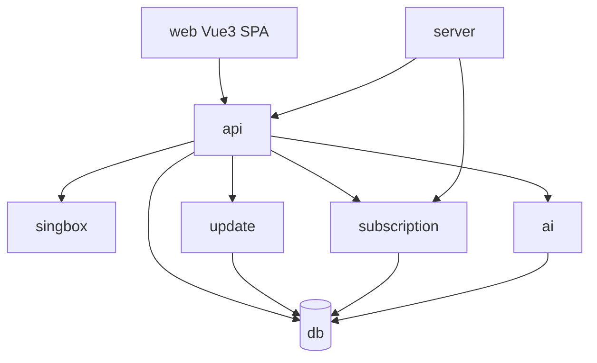

# 代码地图

> `main.go`/`embed.go`/`internal/server`/`internal/api`/`internal/db`/`internal/singbox`/`internal/update`/`web`/`scripts/` 已落码；`subscription`/`ai` 包仍为**规划**，落码后由做改动的会话按「收尾」更新。

## 树

```text
proxy-ui/
├── main.go               # 入口：解析启动参数（addr/data/db）、初始化数据库并启动 HTTP 服务
├── embed.go              # //go:embed all:web/dist 嵌入前端构建产物
├── internal/
│   ├── server/           # Gin 路由装配、会话中间件与统一守卫、SPA 静态资源回退；构造 singbox/update 管理器注入 api
│   ├── api/              # REST handlers，按资源分文件；已落：首次设置/登录/登出/me/改密、内核状态/启停/日志/版本/安装/镜像前缀/应用配置、入站/出站/证书 CRUD、规则模板一键应用/规则/策略组/anti-AD 源与兜底出站
│   ├── db/               # SQLite（glebarez+GORM）连接、全量模型（含证书）、启动自动迁移
│   ├── singbox/          # sing-box 内核：八协议入站/出站字段模型与配置映射、路由规则/规则集（anti-AD 等）/策略组（selector/urltest）映射、聚合生成（BuildConfig）、check 校验、子进程启停/重启、状态与 stdout/stderr 日志采集
│   ├── subscription/     # 订阅导出：singbox/clash(mihomo) 格式、二维码、策略组与 anti-AD 规则（规划）
│   ├── update/           # sing-box 内核版本查询、镜像前缀下载（sha256 校验）与解压安装（GitHub Releases）
│   └── ai/               # AI 供应商配置、对话代理、面板接口工具桥（规划）
├── scripts/
│   └── build.sh          # 一键构建：前端（web 包存在时）+ linux/amd64、darwin/arm64 交叉编译（禁 CGO）
└── web/                  # Vue3 SPA（独立 npm 包，bun + Vite）
    ├── dist/             # 前端构建产物（bun run build 生成），go:embed 嵌入；.gitkeep 占位保底
    ├── src/
    │   ├── api/          # 请求封装（envelope 解包、401 跳登录、错误提示）与鉴权、内核管理、入站/出站/证书、规则模板/规则/策略组/anti-AD、应用配置接口
    │   ├── stores/       # Pinia：auth 鉴权状态（初始化/会话/登录/登出/改密）
    │   ├── views/        # 页面：向导/登录/仪表盘/入站（协议分组新建与列表）/出站（direct 与自定义）/规则（模板/规则/策略组/anti-AD 源）/订阅/AI 助手/设置；订阅/AI 页待后续阶段填充
    │   ├── components/   # 通用组件：AppLayout 侧边导航布局、InboundForm 声明式入站表单引擎、CertManager 证书管理、RuleListCard 规则列表、PolicyGroupCard 策略组列表
    │   ├── inbound-schema.ts # 八协议入站字段 schema、默认值生成（含纯 JS X25519 密钥对）与弱配置警示
    │   └── router/       # 路由与守卫（未登录重定向、已初始化后向导不可达）
    └── package.json      # bun + Vite + TS + Vue3 + @veltra/desktop + Pinia + Vue Router
```

## 模块

| 模块 | 路径 | 职责 | 主要入口 |
| --- | --- | --- | --- |
| server | `internal/server/` | 路由装配、会话守卫、SPA 静态资源 | `New(Options)` |
| api | `internal/api/` | REST handlers，按资源分文件；已落鉴权、首次设置、内核管理、入站/出站/证书管理、全局规则（模板一键应用、规则、策略组、anti-AD 源）与应用配置 | `New(db, sessions, core, updates, dataDir)` |
| db | `internal/db/` | SQLite 连接、全量模型、自动迁移 | `Open(path)` |
| singbox | `internal/singbox/` | 八协议入站/出站/路由（规则、规则集、策略组）配置映射与聚合生成、内核子进程生命周期、状态与日志采集 | `New(dir)` |
| subscription | `internal/subscription/` | 多格式订阅导出、二维码、规则集 | 规划 |
| update | `internal/update/` | 内核版本查询、镜像下载、完整性校验与安装 | `New(db, dir)` |
| ai | `internal/ai/` | AI 对话代理与工具桥 | 规划 |
| web | `web/` | Vue3 SPA：底座、布局导航、登录/向导、设置页（账号/内核管理）、入站/出站管理页（声明式协议表单、弱配置警示与 TLS 跳转、证书管理、应用配置）、规则页（模板一键应用、规则与策略组编辑、anti-AD 源与兜底出站配置）；订阅/AI 页待后续阶段填充 | `src/main.ts` |

## 依赖

已落码部分：`web` → `api`（REST，开发模式经 Vite 代理）、`server` → `api` → `db`、`api` → `singbox`、`api` → `update` → `db`；其余边为规划（subscription/ai 落码后生效）。



## 关键路径

- **启动**：`main.go` → `db.Open` 初始化/迁移 → `server.New` 装配路由、内核管理器与嵌入资源 → HTTP 服务（sing-box 子进程由设置页手动启动）
- **订阅拉取**：客户端 GET 订阅链接（匿名 token）→ server 分流 → subscription 按 UA/参数渲染 sing-box / clash(mihomo) 配置返回
- **在线更新**：内核：设置页点击 → update 经镜像前缀从 GitHub Releases 下载并校验安装到 `<data>/core`；面板自身更新待后续阶段
- **AI 工具调用**：前端 `@veltra/ai` 对话 → ai 模块代理供应商 API → function calling 回落到 api/业务模块执行 → 结果回流对话
