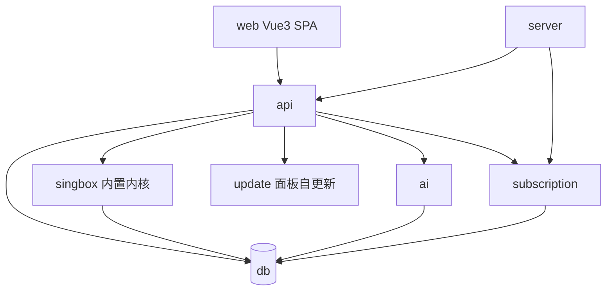

# 代码地图

> 内核以库形式内嵌（`github.com/sagernet/sing-box v1.14.4`），构建需带 `with_v2ray_api` 等标签，详见 `.agents/docs/SPEC-core-embedded.md`。

## 树

```text
proxy-ui/
├── main.go               # 入口：解析启动参数（addr/data/db）、初始化数据库并启动 HTTP 服务；Version 经 ldflags 注入
├── embed.go              # //go:embed all:web/dist 嵌入前端构建产物
├── internal/
│   ├── server/           # Gin 路由装配、会话中间件与统一守卫、SPA 静态资源回退；构造内置内核管理器与统计采集注入 api，注册匿名订阅端点 /sub/:token
│   ├── api/              # REST handlers：鉴权（一次性设置码/登录限流/改密吊销会话）；内核只读状态与日志 + 热应用编排（applyKernelConfig / applyThenOK，所有写 handler 复用；失败置 pendingChanges 供状态接口带出）；面板自更新；实时速率与按用户累计流量；入站 CRUD（随机端口分配，视图只带用户数；用户统一由订阅勾选生成；协议默认值 template 端点）；订阅用户（配额/到期/勾选入站/重置链接/清零流量/双格式配置预览）；出站/证书；规则集与规则（两层模型）/策略组/兜底出站/预设模板（tag 引用一致性：出站与策略组改名级联规则 / 组成员 / 兜底 / DNS detour，删除或停用被引用项拒绝，成员与循环引用在保存处校验）；DNS；AI（工具与 REST 共用各资源 createXxx/updateXxx/deleteXxx 编排）
│   ├── db/               # SQLite（glebarez+GORM）连接、全量模型、启动自动迁移与旧 schema 检测重建（PRAGMA user_version 不符则整库重建为空库）
│   ├── singbox/          # 内置内核：连接层配置模型与协议映射、多用户凭据生成与 users 渲染、路由规则与规则集、DNS 模型与预设、配置聚合（BuildConfig）、进程内实例生命周期（manager.go：Start 失败回滚 lastGood、Apply 配置未变则跳过重建、统计端口按实例动态分配）、v2ray 统计采集（差分内存聚合、5 秒单事务批量落库、失败重试不丢数，stats.go / statsclient.go）
│   ├── subscription/     # 订阅导出：按 token 取用户在各入站的身份→客户端节点、策略组/规则映射、sing-box 与 mihomo 双格式渲染（含 DNS 段与 rule-providers）、配额/到期拒绝、匿名端点、面板内预览（按订阅用户 ID，跳过校验）
│   ├── update/           # 面板自身更新：GitHub Releases 版本查询、下载校验、二进制替换与同 PID 重启（内核不再走此模块）
│   └── ai/               # AI 多供应商/多模型配置存取、上游 /models 拉取、@veltra/ai transport 元数据、按供应商 SSE 对话代理、面板工具注册表
├── README.md             # 运行说明：下载、systemd、反代 TLS、首次向导（一次性设置码）、订阅模型、DNS、BBR 手动开启、内核说明、面板更新
├── CHANGELOG.md          # 发行变更日志（按版本记录面向使用者的变更）
├── Makefile              # dev/dev-api/dev-web/run/build/test/clean（已内置内核构建标签）
├── .github/workflows/
│   ├── ci.yml            # CI：前端构建 + make test + 双平台编译（push/PR 触发）
│   └── release.yml       # 公开发版流水线：v* tag 触发测试、双平台编译（注入 main.Version）、SHA256SUMS 与 GitHub Release
├── scripts/
│   ├── build.sh          # 一键构建：前端 + linux/amd64、darwin/arm64 交叉编译（禁 CGO，含内置内核标签）；产出 bin/checksums.txt，dirty 树默认拒绝（ALLOW_DIRTY=1 放行）
│   ├── install.sh        # linux systemd 安装脚本
│   └── release.sh        # Go 应用公开发版入口脚本（检查、门禁、--dry-run、提交 CHANGELOG 并推送分支与附注 tag）
└── web/                  # Vue3 SPA（独立 npm 包，bun + Vite）
    ├── dist/             # 前端构建产物（go:embed 嵌入）
    └── src/
        ├── api/          # 请求封装与各资源接口（入站/出站/证书/规则+规则集/策略组/订阅用户/统计/内核/DNS/AI/面板更新）
        ├── stores/       # Pinia：auth
        ├── views/        # 向导（一次性设置码）/登录/仪表盘（内核只读状态 + 按需打开的日志弹框、实时速率、按用户累计流量、pendingChanges 黄条）/入站（列表，用户数只读）/出站/证书（一键自签、上传/粘贴 PEM、路径引用，到期倒计时）/规则（按对象分四 tab：路由规则/规则集/策略组/兜底与模板）/订阅用户（配额用量；链接弹框按格式分 tab 带各自二维码；双格式配置预览弹框）/设置（拆分为 settings/ 五个平级 tab：主题/账号/面板更新/AI/DNS，UTableEditor 编辑 DNS 行）
        ├── settings/     # 设置页五个 tab 组件（ThemeTab/AccountTab/PanelUpdateTab/AiTab/DnsTab）及 AI 弹框（AiProviderDialog/AiModelDialog/AiImportDialog）
        ├── components/   # AppLayout、AiChatDialog（顶栏 AI 助手近全屏对话弹框）、EmptyState、FormGroupCard、InboundForm、OutboundEditorDialog、RuleListCard、RuleSetCard、RuleSetDialog、RuleEditDialog、PolicyGroupCard、FinalTemplatesCard、SubscriptionLinksDialog、SubscriptionEditorDialog、SubscriptionPreviewDialog（sing-box/mihomo 双格式只读预览）、KernelLogDialog（仪表盘内核日志，仅打开期间轮询）、DialogFooter
        ├── composables/  # useEnabledOverride（USwitch 失败不下刷 workaround，多列表/卡片共用）
        ├── utils/        # format.ts（formatBytes/formatUptime/formatDateTime）、clipboard.ts（copyText）
        ├── inbound-schema.ts # 七协议字段 schema 与弱配置警示（默认值经 template 端点取后端单一来源）
        └── router/       # 路由与守卫
```

## 模块

| 模块 | 路径 | 职责 | 主要入口 |
| --- | --- | --- | --- |
| server | `internal/server/` | 路由装配、会话守卫、SPA 静态资源、匿名订阅端点；装配完成后异步 `StartKernel` 拉起内核 | `New(Options)` |
| api | `internal/api/` | REST handlers（见上）；`applyKernelConfig` 热应用编排（串行化，失败置 pendingChanges）、`applyThenOK` 落库后热应用并写响应（热应用失败仍成功响应、msg 带原因，内核已回滚）；REST 与 AI 工具共用各资源 createXxx/updateXxx/deleteXxx 编排；`ReconcileQuota` 全量 / `ReconcileQuotaTokens` 增量刷新配额暂停状态 | `New(db, sessions, core, selfUpdates, stats, dataDir)` |
| db | `internal/db/` | SQLite 连接、模型、自动迁移；旧 schema 库自动重建为空库 | `Open(path)` |
| singbox | `internal/singbox/` | 配置模型与映射、多用户渲染、路由与规则集、DNS、进程内内核生命周期（`Apply` 幂等应用 + 失败回滚）、v2ray 统计采集 | `New(dir)` / `NewStatsMonitor(mgr, db)` |
| subscription | `internal/subscription/` | 订阅组装与双格式渲染、配额拒绝、匿名端点、面板内预览（跳过停用/配额/到期校验） | `New(db, dataDir)` |
| update | `internal/update/` | 面板自身版本查询与自更新 | `NewSelfUpdate(version)` |
| ai | `internal/ai/` | 多供应商与多模型配置（key 不回显、模型 id 全局唯一）、上游 /models 拉取、transport 元数据、按供应商 SSE 对话代理、工具注册表 | `New(db)` |
| web | `web/` | Vue3 SPA | `src/main.ts` |

## 依赖

`web` → `api`（REST，开发模式经 Vite 代理）、`server` → `api` → `db`、`server` → `subscription` → `db`、`api` → `singbox`（内核实例 + 统计）→ `db`、`api` → `update`（面板自更新）、`api` → `ai` → `db`、`api` → `subscription`（订阅预览）。



## 关键路径

- **启动**：`main.go` → `db.Open` 校验 schema 版本（旧库先备份 `*.bak-<旧版本>` 再整库重建为空库）并迁移 → `server.New` 装配路由、内核管理器（进程内）与嵌入资源（未初始化时生成一次性设置码打印进启动日志）→ 后台 `api.StartKernel` 立即拉起内核（失败只告警，面板照常可用）→ HTTP 服务
- **入站 → 用户**：创建入站（端口留空则分配随机空闲端口）→ 订阅用户勾选该入站 → `api.syncTokenNodes` 在该入站下建 `InboundUser` 并写 `SubscriptionNode` 绑定
- **订阅拉取**：客户端 GET `/sub/:token` → subscription 校验停用/到期/配额 → 取该 token 在各入站中未暂停的用户 → 渲染 sing-box / mihomo 配置（同一入站的节点共享 `server_port`）
- **订阅预览**：管理端 GET `/api/subscription/tokens/:id/preview?format=sing-box|mihomo` → `subscription.Preview` 跳过停用/配额/到期校验，共用匿名端点同一 `assemble`/`Render`（内容一致，差异只在校验）；无可用节点时返回 400 与原因。AI 工具 `preview_subscription` 走同一路径
- **配额执行**：`StatsMonitor` 每秒经 v2ray 统计 gRPC 读 `user>>>` 计数器，差分内存聚合后每 5 秒单事务批量累加进 `user_traffics`（失败重试不丢数）→ flush 成功即对本轮有流量的 token 调 `api.ReconcileQuotaTokens` 即时核对，超限/到期/停用则置 `InboundUser.enabled=false`（30s `ReconcileQuota` 循环兜底）→ `buildKernelConfig` 只输出启用用户（无用户的入站跳过），订阅端点返回 403
- **保存即热应用**：任一写 handler 落库成功后调 `api.applyKernelConfig`（`applyMu` 串行化）→ `buildKernelConfig` 聚合入站+用户/出站/规则/策略组/DNS（无可用入站时用 `singbox.MinConfig()`）→ `core.CheckConfig` 校验 → `core.Apply(cfg)`（配置未变跳过；失败由 Manager 回滚 `lastGood`）→ 失败则 `applyThenOK` 仍写成功响应、msg 携带原因（前端 `request()` 对非 ok msg 弹警告；数据保留），并置 `pendingChanges`，内核状态接口带出、仪表盘常驻黄条直到下次成功应用。不存在「应用配置」接口与按钮
- **DNS 双端生效**：设置页保存到 `SettingDNS` → `BuildConfig` 写入服务端 `dns` 段与 `route.default_domain_resolver`，并随订阅下发（mihomo 渲染等价 `dns:` 段）
- **AI 工具调用**：前端 `@veltra/ai` 编排工具循环 → POST `/api/ai/tools/call` → api 按名回落业务模块 → 结果回灌模型；对话本体按供应商经 `/api/ai/providers/:id/chat` 代理上游 SSE（transport 元数据来自 `GET /api/ai/transport`）
